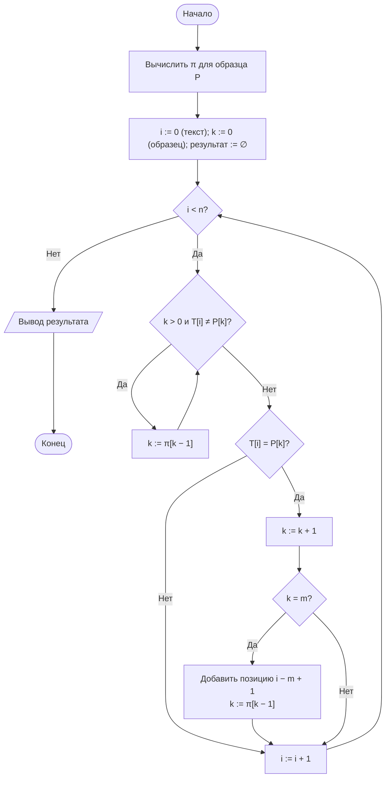
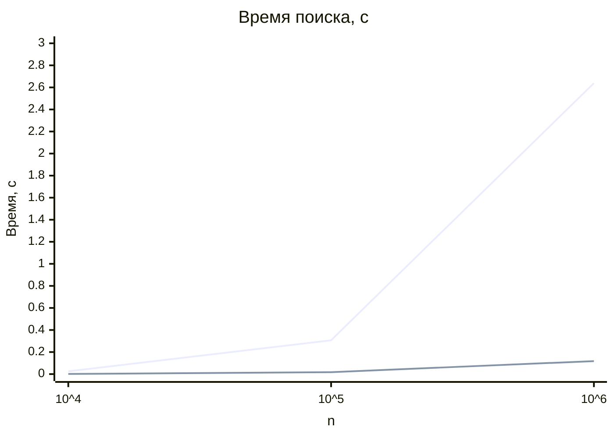
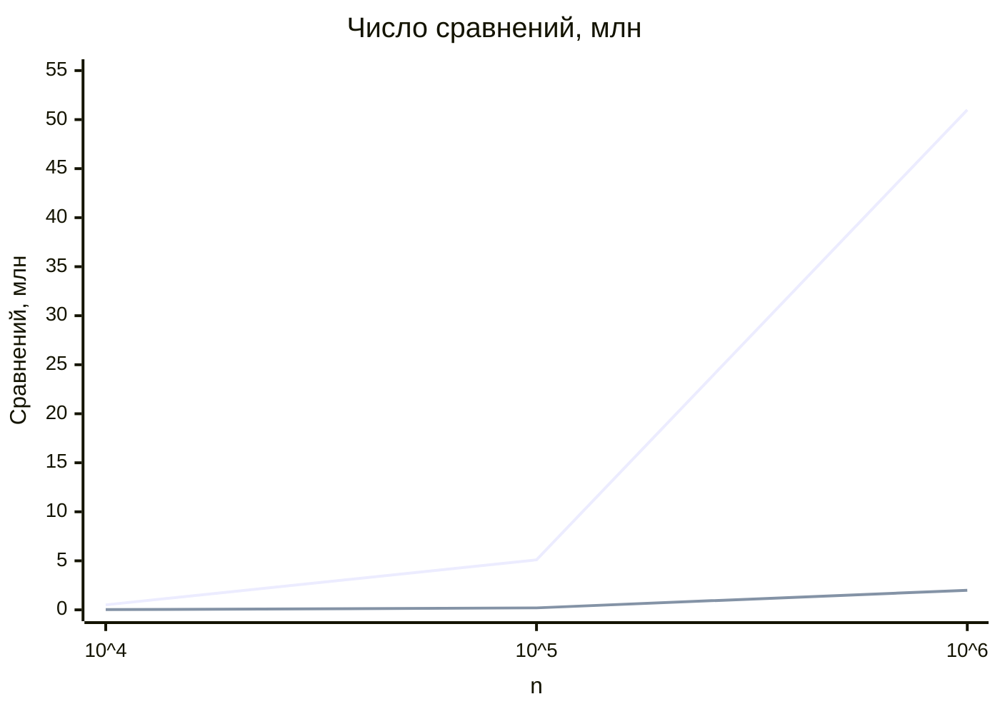

<div align="center">

**МИНИСТЕРСТВО НАУКИ И ВЫСШЕГО ОБРАЗОВАНИЯ РОССИЙСКОЙ ФЕДЕРАЦИИ**

*(полное наименование образовательной организации)*

Кафедра ____________________

# ОТЧЁТ
## по лабораторной работе № 11
### «Алгоритмы поиска подстроки и вычисления редакционного расстояния»

**Дисциплина:** Теория алгоритмов
**Направление подготовки:** 38.03.05 «Бизнес-информатика»
**Вариант:** 7

&nbsp;

Выполнила: студентка группы БИ 2-3 Иванюшкина Дарья Андреевна

Проверил: ______________________ (ФИО преподавателя)

&nbsp;

Москва, 2026

</div>

---

## 1. Цель работы и задание варианта

**Цель работы:** изучить алгоритмы обработки текстовых данных — точный поиск подстроки и оценку близости строк — и применить их к задаче сопоставления записей из разных информационных систем.

**Задание варианта 7** (табл. 1 методических указаний):

| Параметр | Значение |
|---|---|
| Образец для ручного расчёта $\pi$ | aabbaab |
| Тип текста | С повторами |
| Длины текста $n$ | $10^4$; $10^5$; $10^6$ |
| Порог сходства | 0,75 |
| Дополнительное задание | Л7 — расширенная нормализация: транслитерация, обработка сокращений («ул.» и «улица»), кавычки разных видов; оценка прироста доли точных совпадений |

**Задачи:**

1. Реализовать наивный поиск подстроки и алгоритм Кнута — Морриса — Пратта (КМП) с префикс-функцией.
2. Вычислить префикс-функцию образца «aabbaab» вручную и сверить с программой.
3. Сравнить время и число сравнений на тексте с повторами при $n = 10^4, 10^5, 10^6$.
4. Реализовать расстояние Левенштейна и меру сходства.
5. Решить задачу сопоставления наименований контрагентов (порог 0,75) и выполнить задание Л7.

**Принятые параметры.** «Текст с повторами» — строка из $n$ символов `a`, образец — 50 символов `a` и завершающий `b` (худший случай наивного алгоритма). Для демонстрации образца варианта используется короткий текст «aabbaabbaabbaab», содержащий три перекрывающихся вхождения «aabbaab».

---

## 2. Описание алгоритмов и оценки сложности

### 2.1. Наивный поиск

Образец прикладывается ко всем позициям текста, и в каждой выполняется посимвольное сравнение. Трудоёмкость в худшем случае $\Theta((n - m + 1) \cdot m) = \Theta(nm)$; худший случай достигается на тексте $a^n$ и образце $a^{m-1}b$: в каждой позиции совпадают $m - 1$ символов и лишь последний не совпадает.

### 2.2. Алгоритм Кнута — Морриса — Пратта

При несовпадении указатель в тексте не возвращается назад: образец сдвигается на величину, вычисленную заранее по самому образцу с помощью **префикс-функции**. $\pi[i]$ — длина наибольшего **собственного** префикса подстроки $P[0..i]$, который одновременно является её суффиксом. Трудоёмкость: предобработка $\Theta(m)$, поиск $\Theta(n)$, итого $\Theta(n + m)$ (величина $k$ — длина текущего совпадения — растёт не более чем на 1 за шаг и уменьшается при откатах $k := \pi[k-1]$, поэтому общее число откатов не превосходит $n$).

| Алгоритм | Предобработка | Поиск | Худший случай |
|---|---|---|---|
| Наивный | нет | — | $\Theta(nm)$ |
| КМП | $\Theta(m)$ | $\Theta(n)$ | $\Theta(n + m)$ |

### 2.3. Расстояние Левенштейна

Минимальное число вставок, удалений и замен символа, переводящих $A$ в $B$. Рекуррентное соотношение для таблицы $D$ ($D[i][j]$ — расстояние между префиксами $A[0..i-1]$ и $B[0..j-1]$):

$$D[i][j] = \min \begin{cases} D[i-1][j] + 1 & \text{(удаление)}, \\ D[i][j-1] + 1 & \text{(вставка)}, \\ D[i-1][j-1] + c_{ij} & \text{(замена)}, \end{cases} \qquad c_{ij} = [A[i-1] \ne B[j-1]], \quad D[i][0] = i, \ D[0][j] = j.$$

Трудоёмкость $\Theta(nm)$ по времени и по памяти. **Мера сходства:** $\text{sim}(A, B) = 1 - d(A, B) / \max(\lvert A \rvert, \lvert B \rvert) \in [0; 1]$.

### 2.4. Сопоставление записей

1. **Нормализация** строк (регистр, знаки препинания, кавычки, организационно-правовые формы, сокращения, транслитерация).
2. **Точное сопоставление** нормализованных строк.
3. **Нечёткое сопоставление** остальных записей по мере сходства с порогом 0,75.

Сравнение «каждый с каждым» имеет трудоёмкость $\Theta(N^2 L^2)$ ($N$ — число записей, $L$ — длина), поэтому при больших $N$ нужна предварительная фильтрация кандидатов.

---

## 3. Ручной расчёт префикс-функции для образца «aabbaab»

Индексы символов образца:

| $i$ | 0 | 1 | 2 | 3 | 4 | 5 | 6 |
|---|---|---|---|---|---|---|---|
| $P[i]$ | a | a | b | b | a | a | b |

| Шаг | Префикс $P[0..i]$ | Наибольший собственный префикс, равный суффиксу | $\pi[i]$ |
|---|---|---|---|
| 1 | a | нет (собственных префиксов нет) | 0 |
| 2 | aa | «a» | 1 |
| 3 | aab | нет (префиксы a, aa; суффиксы b, ab) | 0 |
| 4 | aabb | нет (суффиксы b, bb, abb) | 0 |
| 5 | aabba | «a» (префикс «aa» не равен суффиксу «ba») | 1 |
| 6 | aabbaa | «aa» (префикс «aab» не равен суффиксу «baa») | 2 |
| 7 | aabbaab | «aab» (префикс «aabb» не равен суффиксу «baab») | 3 |

**Результат:** $\pi = [0, 1, 0, 0, 1, 2, 3]$.

**Смысл.** Допустим, при поиске совпали 6 символов «aabbaa», а седьмой не совпал. Так как $\pi[5] = 2$, последние два совпавших символа «aa» уже образуют начало образца, и сравнение продолжается с третьего символа образца ($k := 2$) — без возврата по тексту. Если совпал весь образец (7 символов), то $k := \pi[6] = 3$: последние три символа «aab» уже являются началом нового вхождения, поэтому следующее вхождение может перекрываться с предыдущим на 3 символа (сдвиг на $7 - 3 = 4$). Именно это видно на тексте «aabbaabbaabbaab»: вхождения найдены на позициях 0, 4, 8.

**Результат программы** совпал с ручным расчётом:

```
π для aabbaab : [0, 1, 0, 0, 1, 2, 3]
Вхождения в aabbaabbaabbaab : [0, 4, 8]
```

---

## 4. Блок-схема алгоритма КМП



---

## 5. Фрагмент таблицы редакционного расстояния

Пара коротких слов: «сумма» → «сума» (удалить одну букву «м»). Строки таблицы соответствуют префиксам слова «сумма», столбцы — префиксам слова «сума».

| | ∅ | с | у | м | а |
|---|---|---|---|---|---|
| **∅** | 0 | 1 | 2 | 3 | 4 |
| **с** | 1 | 0 | 1 | 2 | 3 |
| **у** | 2 | 1 | 0 | 1 | 2 |
| **м** | 3 | 2 | 1 | 0 | 1 |
| **м** | 4 | 3 | 2 | 1 | 1 |
| **а** | 5 | 4 | 3 | 2 | 1 |

Пояснение: на диагонали стоят нули, пока буквы совпадают («с», «у», «м»); вторая «м» слова «сумма» не имеет пары — ячейка $D[4][4] = \min(D[3][4] + 1,\ D[4][3] + 1,\ D[3][3] + 1) = \min(2, 2, 1) = 1$ (удаление лишней «м»); буква «а» совпадает, и значение 1 переносится по диагонали в $D[5][4]$. **Ответ: $d = 1$**, сходство $1 - 1/5 = 0{,}800$.

Таблица напечатана программой:

```
   [0, 1, 2, 3, 4]
   [1, 0, 1, 2, 3]
   [2, 1, 0, 1, 2]
   [3, 2, 1, 0, 1]
   [4, 3, 2, 1, 1]
   [5, 4, 3, 2, 1]
```

---

## 6. Листинг программы

Файл `lab11_variant7.py` (Python 3.10+, PyCharm; дополнительных библиотек не требуется).

```python
"""ЛР № 11, вариант 7: наивный поиск и КМП на текстах с повторами (n = 10^4, 10^5, 10^6),
расстояние Левенштейна, сопоставление контрагентов (порог 0,75), доп. задание Л7 — расширенная нормализация."""
import re
import time


def naive_search(text, p):                       # наивный поиск: (позиции, число сравнений символов)
    pos, cmp_ = [], 0
    for i in range(len(text) - len(p) + 1):
        j = 0
        while j < len(p):
            cmp_ += 1
            if text[i + j] != p[j]:
                break
            j += 1
        if j == len(p):
            pos.append(i)
    return pos, cmp_


def prefix_function(p):                          # π[i] — длина наибольшего собственного префикса p[0..i], равного суффиксу
    pi, k = [0] * len(p), 0
    for i in range(1, len(p)):
        while k > 0 and p[i] != p[k]:
            k = pi[k - 1]
        if p[i] == p[k]:
            k += 1
        pi[i] = k
    return pi


def kmp_search(text, p):                         # алгоритм Кнута — Морриса — Пратта, Θ(n + m)
    pi, pos, cmp_, k = prefix_function(p), [], 0, 0
    for i, c in enumerate(text):
        while k > 0 and c != p[k]:
            cmp_ += 1
            k = pi[k - 1]
        cmp_ += 1
        if c == p[k]:
            k += 1
        if k == len(p):
            pos.append(i - len(p) + 1)
            k = pi[k - 1]
    return pos, cmp_


def lev_table(a, b):                             # полная таблица редакционного расстояния
    D = [[i] + [0] * len(b) for i in range(len(a) + 1)]
    D[0] = list(range(len(b) + 1))
    for i in range(1, len(a) + 1):
        for j in range(1, len(b) + 1):
            D[i][j] = min(D[i - 1][j] + 1, D[i][j - 1] + 1, D[i - 1][j - 1] + (a[i - 1] != b[j - 1]))
    return D


def similarity(a, b):                            # 1 − d / max(|a|, |b|)
    return 1.0 if not a and not b else 1 - lev_table(a, b)[-1][-1] / max(len(a), len(b))


LEGAL = {"ооо", "оао", "зао", "пао", "ао", "ип"}
QUOTES = "«»„“”‘’‹›\"'`"                          # кавычки разных видов
ABBR = {"ул": "улица", "д": "дом", "г": "город", "пр-т": "проспект", "пер": "переулок", "корп": "корпус"}
TRANS = {"sh": "ш", "ch": "ч", "zh": "ж", "ya": "я", "yu": "ю", "kh": "х", "ts": "ц", "a": "а", "b": "б", "v": "в",
         "g": "г", "d": "д", "e": "е", "z": "з", "i": "и", "j": "й", "k": "к", "l": "л", "m": "м", "n": "н", "o": "о",
         "p": "п", "r": "р", "s": "с", "t": "т", "u": "у", "f": "ф", "h": "х", "c": "к", "y": "ы"}


def translit(word):                              # латиница → кириллица (простая транслитерация)
    out, i = "", 0
    while i < len(word):
        for size in (2, 1):                      # сначала пробуем пары букв (sh, ya, ...)
            if word[i:i + size] in TRANS:
                out += TRANS[word[i:i + size]]
                i += size
                break
        else:
            out += word[i]
            i += 1
    return out


def normalize(name, extended=True):              # нормализация наименования; extended — Л7
    s = name.lower().replace("ё", "е")
    s = re.sub("[" + re.escape(QUOTES if extended else "«»„“”\"'") + r".,;:()]", " ", s)
    words = s.split()
    if extended:
        words = [translit(w) if re.search("[a-z]", w) else w for w in words]   # транслитерация
        words = [ABBR.get(w, w) for w in words]                                # «ул» → «улица» и т. п.
    return " ".join(w for w in words if w not in LEGAL)


def match(list_a, list_b, extended, threshold=0.75):    # для каждой записи А — лучшая запись Б
    nb, res = [normalize(b, extended) for b in list_b], []
    for a in list_a:
        na = normalize(a, extended)
        sims = [1.0 if na == x else similarity(na, x) for x in nb]
        j = max(range(len(nb)), key=lambda i: sims[i])
        kind = "точное" if sims[j] == 1.0 else "нечёткое"
        res.append((j, sims[j], kind) if sims[j] >= threshold else (None, sims[j], "не найдено"))
    return res


def main():
    p = "aabbaab"                                # образец варианта 7
    print("π для", p, ":", prefix_function(p))
    t = "aabbaabbaabbaab"
    assert naive_search(t, p)[0] == kmp_search(t, p)[0]
    print("Вхождения в", t, ":", kmp_search(t, p)[0])
    print(f"\n{'n':>8}{'наивный,с':>11}{'КМП,с':>9}{'сравн.(наив.)':>15}{'сравн.(КМП)':>13}")
    for n in (10 ** 4, 10 ** 5, 10 ** 6):        # текст с повторами: n символов «a», образец a…ab
        text, pat = "a" * n, "a" * 50 + "b"
        t0 = time.perf_counter(); r1, c1 = naive_search(text, pat); t1 = time.perf_counter() - t0
        t0 = time.perf_counter(); r2, c2 = kmp_search(text, pat); t2 = time.perf_counter() - t0
        assert r1 == r2
        print(f"{n:>8}{t1:>11.4f}{t2:>9.4f}{c1:>15}{c2:>13}")
    a, b = "сумма", "сума"
    print(f"\nТаблица Левенштейна «{a}» → «{b}»:")
    for row in lev_table(a, b):
        print("  ", row)
    A = ['ООО «Ромашка», ул. Ленина, д. 5', 'АО «Василёк», пр-т Мира, д. 10', 'ПАО «Гранит», пер. Школьный, д. 3',
         'ООО «Северный ветер», ул. Садовая, д. 7', 'ЗАО «Альфа-Строй», г. Москва, ул. Тверская, д. 1',
         'ИП Иванов И.И., ул. Победы, д. 12', 'ООО «Вектор», ул. Ленина, д. 20', 'АО «Прогресс», пр-т Мира, д. 15',
         'ООО «Меридиан», ул. Горького, д. 8', 'ПАО «Сигма», г. Казань']
    B = ['Ромашка ООО, улица Ленина, дом 5', 'Vasilek AO, prospekt Mira, d. 10', '“Гранит” ПАО, переулок Школьный, дом 3',
         'Severnyj veter OOO, ul. Sadovaya, d. 7', 'ZAO "Alfa-Stroy", g. Moskva, ul. Tverskaya, d. 1',
         'Иванов Иван Иванович, ИП, ул. Победы, д. 12', 'ООО «Вектор-Плюс», ул. Ленина, д. 20',
         'AO Progress, pr-t Mira, d. 15', 'Меридиан ООО, ул. Горького, д. 8', '«Сигма» ПАО, г. Казань']
    truth = [0, 1, 2, 3, 4, 5, None, 7, 8, 9]    # настоящие пары: A[i] ↔ B[truth[i]]; «Вектор» ≠ «Вектор-Плюс»
    for ext in (False, True):
        res = match(A, B, ext)
        exact = sum(r[2] == "точное" and r[0] == truth[i] for i, r in enumerate(res))
        right = sum(r[0] == truth[i] for i, r in enumerate(res) if truth[i] is not None)
        wrong = sum(r[0] is not None and r[0] != truth[i] for i, r in enumerate(res))
        print(f"\n{'Расширенная' if ext else 'Базовая'} нормализация: точных {exact}/9 ({exact / 9 * 100:.0f} %), "
              f"верных пар {right}/9, ложных {wrong}")
        if ext:
            for i, (j, s, kind) in enumerate(res):
                print(f"  {A[i][:36]:<36} → {B[j][:38] if j is not None else '—':<38} {s:.3f} ({kind})")


if __name__ == "__main__":
    main()
```

---

## 7. Результаты измерений

Измерения выполнены в среде Linux, Python 3.13.

**Таблица 1. Сравнение алгоритмов поиска на тексте с повторами ($T = a^n$, $P = a^{50}b$)**

| $n$ | Наивный, с | КМП, с | Сравнений (наивный) | Сравнений (КМП) | Отношение времени |
|---|---|---|---|---|---|
| $10^4$ | 0,0250 | 0,0011 | 507 450 | 19 950 | 22,7 |
| $10^5$ | 0,3067 | 0,0176 | 5 097 450 | 199 950 | 17,4 |
| $10^6$ | 2,6388 | 0,1178 | 50 997 450 | 1 999 950 | 22,4 |

**Анализ.**

- Число сравнений наивного алгоритма равно $(n - 50) \cdot 51$ (в каждой из $n - 50$ позиций сравниваются 51 символ) — порядка $nm$; при $n = 10^6$ это почти 51 млн сравнений.
- Число сравнений КМП — около $2n$ (1 999 950 при $n = 10^6$): линейно по $n$. Число сравнений у КМП меньше в 25,5 раза, время — в 17–23 раза (в Python накладные расходы на другие операции уменьшают выигрыш по времени).
- Оба алгоритма находят одинаковый результат (пустой список вхождений; проверено `assert`).

**Графики** (диаграммы Mermaid):





---

## 8. Результат сопоставления записей (порог сходства 0,75)

Данные: 10 записей контрагентов в системе А (стандартная запись «наименование, адрес») и 10 записей в системе Б (те же организации с иной записью: другой порядок слов, латиница, сокращения, разные кавычки). Ожидаемые пары — A[i] ↔ Б[i], кроме записи 7: «Вектор» и «Вектор-Плюс» — разные организации.

**Таблица 2. Результат сопоставления с расширенной нормализацией**

| № | Система А | Система Б | Сходство | Тип |
|---|---|---|---|---|
| 1 | ООО «Ромашка», ул. Ленина, д. 5 | Ромашка ООО, улица Ленина, дом 5 | 1,000 | точное |
| 2 | АО «Василёк», пр-т Мира, д. 10 | Vasilek AO, prospekt Mira, d. 10 | 1,000 | точное |
| 3 | ПАО «Гранит», пер. Школьный, д. 3 | “Гранит” ПАО, переулок Школьный, дом 3 | 1,000 | точное |
| 4 | ООО «Северный ветер», ул. Садовая, д. 7 | Severnyj veter OOO, ul. Sadovaya, d. 7 | 1,000 | точное |
| 5 | ЗАО «Альфа-Строй», г. Москва, ул. Тверская, д. 1 | ZAO "Alfa-Stroy", g. Moskva, ul. Tverskaya, d. 1 | 0,956 | нечёткое |
| 6 | ИП Иванов И.И., ул. Победы, д. 12 | Иванов Иван Иванович, ИП, ул. Победы, д. 12 | 0,750 | нечёткое |
| 7 | ООО «Вектор», ул. Ленина, д. 20 | ООО «Вектор-Плюс», ул. Ленина, д. 20 | 0,839 | нечёткое (**ложное**) |
| 8 | АО «Прогресс», пр-т Мира, д. 15 | AO Progress, pr-t Mira, d. 15 | 1,000 | точное |
| 9 | ООО «Меридиан», ул. Горького, д. 8 | Меридиан ООО, ул. Горького, д. 8 | 1,000 | точное |
| 10 | ПАО «Сигма», г. Казань | «Сигма» ПАО, г. Казань | 1,000 | точное |

**Разбор нечётких случаев:**

- **Запись 5:** транслитерация «Alfa-Stroy» даёт «алфа-стрый» вместо «альфа-строй» (нет мягкого знака, «y» передаётся как «ы»); расстояние 2 на ~46 символов, сходство 0,956 — пара найдена корректно.
- **Запись 6:** «Иванов И.И.» и «Иванов Иван Иванович» — один человек, но инициалы против полных слов; сходство ровно 0,750, то есть пара найдена **на границе порога**; при пороге 0,80 она была бы потеряна.
- **Запись 7:** «Вектор» и «Вектор-Плюс» — разные организации, но при одинаковом адресе сходство 0,839 выше порога: **ложное срабатывание**. Чтобы его исключить, порог нужно поднять выше 0,84, но тогда будут потеряны пары 6 (0,750) и, возможно, другие нечёткие пары. Это типичный компромисс между полнотой и точностью; сомнительные пары следует отправлять на ручную проверку.

---

## 9. Дополнительное задание Л7: оценка прироста доли точных совпадений

Сравниваются две нормализации на тех же 10 записях (9 настоящих пар):

- **Базовая** (как в образце методички): нижний регистр, замена «ё» на «е», удаление кавычек « » „ “ ” " ' и знаков «.,;:()», удаление организационно-правовых форм (ООО, ПАО, ЗАО, АО, ИП).
- **Расширенная** (Л7): дополнительно кавычки ‘ ’ ‹ › ` ; **транслитерация** латиницы в кириллицу (в том числе пары sh, ch, zh, ya, yu, kh, ts); **раскрытие сокращений** (ул → улица, д → дом, г → город, пр-т → проспект, пер → переулок, корп → корпус).

**Таблица 3. Влияние нормализации**

| Показатель | Базовая | Расширенная | Прирост |
|---|---|---|---|
| Точные совпадения (из 9 настоящих пар) | 2 (22 %) | 7 (78 %) | **+56 п. п.** |
| Верно найденные пары (точные + нечёткие при пороге 0,75) | 4 из 9 (44 %) | 9 из 9 (100 %) | +56 п. п. |
| Ложные срабатывания | 1 | 1 | 0 |

При базовой нормализации точными оказались лишь пары 9 и 10 (отличаются только порядком слов и формой записи юридической формы); остальные записи расходились сокращениями («ул» и «улица»), кириллицей и латиницей. Расширенная нормализация сняла эти различия: из 9 настоящих пар точными стали 7, а оставшиеся две (записи 5 и 6) найдены нечётко. Ложное срабатывание для «Вектор» ↔ «Вектор-Плюс» (разные организации) осталось, поскольку при нормализации различие в названии не исчезает.

**Полный вывод программы:**

```
π для aabbaab : [0, 1, 0, 0, 1, 2, 3]
Вхождения в aabbaabbaabbaab : [0, 4, 8]

       n  наивный,с    КМП,с  сравн.(наив.)  сравн.(КМП)
   10000     0.0250   0.0011         507450        19950
  100000     0.3067   0.0176        5097450       199950
 1000000     2.6388   0.1178       50997450      1999950

Таблица Левенштейна «сумма» → «сума»:
   [0, 1, 2, 3, 4]
   [1, 0, 1, 2, 3]
   [2, 1, 0, 1, 2]
   [3, 2, 1, 0, 1]
   [4, 3, 2, 1, 1]
   [5, 4, 3, 2, 1]

Базовая нормализация: точных 2/9 (22 %), верных пар 4/9, ложных 1

Расширенная нормализация: точных 7/9 (78 %), верных пар 9/9, ложных 1
  ООО «Ромашка», ул. Ленина, д. 5      → Ромашка ООО, улица Ленина, дом 5       1.000 (точное)
  АО «Василёк», пр-т Мира, д. 10       → Vasilek AO, prospekt Mira, d. 10       1.000 (точное)
  ПАО «Гранит», пер. Школьный, д. 3    → “Гранит” ПАО, переулок Школьный, дом 3 1.000 (точное)
  ООО «Северный ветер», ул. Садовая, д → Severnyj veter OOO, ul. Sadovaya, d. 7 1.000 (точное)
  ЗАО «Альфа-Строй», г. Москва, ул. Тв → ZAO "Alfa-Stroy", g. Moskva, ul. Tvers 0.956 (нечёткое)
  ИП Иванов И.И., ул. Победы, д. 12    → Иванов Иван Иванович, ИП, ул. Победы,  0.750 (нечёткое)
  ООО «Вектор», ул. Ленина, д. 20      → ООО «Вектор-Плюс», ул. Ленина, д. 20   0.839 (нечёткое)
  АО «Прогресс», пр-т Мира, д. 15      → AO Progress, pr-t Mira, d. 15          1.000 (точное)
  ООО «Меридиан», ул. Горького, д. 8   → Меридиан ООО, ул. Горького, д. 8       1.000 (точное)
  ПАО «Сигма», г. Казань               → «Сигма» ПАО, г. Казань                 1.000 (точное)
```

---

## 10. Выводы

1. На тексте с повторами наивный алгоритм выполняет $\Theta(nm)$ сравнений: при $n = 10^6$ — почти 51 млн против 2 млн у КМП (разница в 25,5 раза), время работы — 2,64 с против 0,12 с. Это подтверждает оценки $\Theta(nm)$ и $\Theta(n + m)$. Худший случай наивного алгоритма реализуется на реальных данных (журналы с однотипными записями, длинные повторяющиеся разделители).
2. Префикс-функция образца «aabbaab» $\pi = [0, 1, 0, 0, 1, 2, 3]$ вычислена вручную и подтверждена программой. Значение $\pi[6] = 3$ показывает, что вхождения могут перекрываться на 3 символа, что видно на тексте «aabbaabbaabbaab» (позиции 0, 4, 8).
3. Расстояние Левенштейна корректно учитывает пропущенные и лишние буквы: «сумма» → «сума» — расстояние 1, сходство 0,800.
4. Расширенная нормализация (транслитерация, раскрытие сокращений, кавычки разных видов) увеличивает долю точных совпадений с 22 % до 78 % (+56 п. п.) и снимает необходимость нечёткого сравнения для большинства записей; нечёткое сопоставление следует применять только к остатку.
5. Порог сходства — компромисс: при 0,75 найдена пара «Иванов И.И.» ↔ «Иванов Иван Иванович» (0,750, на самой границе), но появилось ложное срабатывание «Вектор» ↔ «Вектор-Плюс» (0,839). Повышение порога устраняет ложные пары, но теряет верные; сомнительные случаи (сходство в диапазоне 0,75–0,85) целесообразно передавать на ручную проверку.
6. Ограничение метода: сравнение «каждый с каждым» имеет трудоёмкость $\Theta(N^2 L^2)$ и при большом числе записей требует предварительного блокирования кандидатов (по первой букве, по длине, по адресу).

---

## 11. Ответы на контрольные вопросы (кратко)

1. Даны текст $T$ длиной $n$ и образец $P$ длиной $m$; найти все $i$, для которых $T[i..i+m-1] = P$. Наивный алгоритм в худшем случае — $\Theta(nm)$.
2. $T = a^n$, $P = a^{m-1}b$: в каждой позиции совпадают $m - 1$ символов, и несовпадение обнаруживается лишь на последнем.
3. $\pi[i]$ — длина наибольшего собственного префикса $P[0..i]$, равного его суффиксу. Для «aabaaab»: $[0, 1, 0, 1, 2, 2, 3]$.
4. Информация о том, какая часть образца уже совпала, хранится в $\pi$; после несовпадения образец сдвигается на вычисленную величину, а символы текста, которые уже сопоставлены, повторно не сравниваются.
5. Указатель $k$ в образце растёт не более чем на 1 за шаг по тексту, а каждый откат $k := \pi[k-1]$ уменьшает его; поэтому общее число откатов не больше $n$. Предобработка аналогично линейна по $m$.
6. $D[i][j] = \min(D[i-1][j] + 1,\ D[i][j-1] + 1,\ D[i-1][j-1] + c_{ij})$: удаление символа $A$, вставка символа $B$, замена (стоимость 0, если символы совпали).
7. Хранить только две строки таблицы: память $\Theta(\min(n, m))$; теряется возможность восстановить последовательность операций.
8. $\text{sim}(A, B) = 1 - d / \max(\lvert A\rvert, \lvert B\rvert) \in [0; 1]$; нормировка нужна, чтобы расстояние 1 для коротких и длинных строк оценивалось по-разному.
9. Нормализация → точное сопоставление → нечёткое по порогу. Точное сопоставление выполняется первым, так как оно дёшево (хеш-таблица) и снимает большую часть записей.
10. Трудоёмкость $\Theta(N^2 L^2)$ при больших $N$ слишком велика; её снижают блокированием кандидатов (по первой букве, длине, адресу) и предварительным точным сопоставлением.

---

## 12. Использованная литература

1. Кормен Т., Лейзерсон Ч., Ривест Р., Штайн К. Алгоритмы: построение и анализ. — 3-е изд. — М.: Вильямс, 2013. — Гл. 32.
2. Кнут Д. Э. Искусство программирования. Т. 3. Сортировка и поиск. — 2-е изд. — М.: Вильямс, 2017.
3. Гасфилд Д. Строки, деревья и последовательности в алгоритмах. — СПб.: БХВ-Петербург, 2003.
4. Седжвик Р., Уэйн К. Алгоритмы на Java. — 4-е изд. — М.: Вильямс, 2013. — Гл. 5.
5. Левенштейн В. И. Двоичные коды с исправлением выпадений, вставок и замещений символов // Доклады АН СССР. — 1965. — Т. 163, № 4. — С. 845–848.
